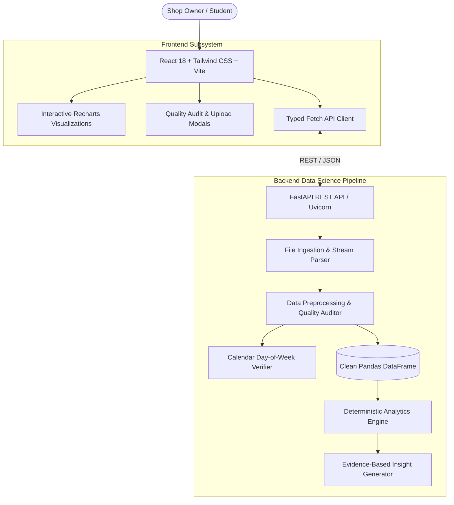

# Architecture Documentation

## Small Shop Sales Pattern Analysis Using Data Science

### 1. High-Level System Architecture

The application is architected as a lightweight, reproducible, local-first analytics application designed to run on standard consumer hardware (Core i3+, 4GB+ RAM) with zero cloud dependencies.

### 2. Module Decomposition

#### A. Ingestion & File Parser (`backend/app/api/endpoints.py`)
- Accepts `.csv`, `.tsv`, and `.xlsx` (Excel) formats via multipart form-data.
- Enforces a 50MB file size ceiling.
- Transparently decodes files with UTF-8 or Latin-1 fallback encoding.

#### B. Preprocessing & Quality Audit (`backend/app/services/preprocessor.py`)
- **Auto-Detection Layer:** Case-insensitive, token-aware heuristics map column names to standard fields.
- **Calendar Reconciliation:** Recomputes the true Gregorian day-of-week for every parsed date. Flags and corrects student misannotations (e.g. `01-02-2026` marked as Monday when it was Sunday).
- **Double-Counting Guard:** Distinguishes between unit-based datasets (`Quantity × Price`) and pre-calculated line totals (`Total_Sales`), preventing erroneous multiplication.
- **Auditing & Imputation:** Tracks missing values, flags duplicates, drops irrecoverable rows (e.g. negative quantities, negative prices, unparseable dates), and imputes default category labels.

#### C. Analytics Engine (`backend/app/analytics/engine.py`)
- Independent, deterministic aggregation functions:
  - Total turnover, units sold, record counts, active trading days.
  - Product-level rankings (by revenue and by unit volume).
  - Category-level revenue shares and product counts.
  - Time-series daily sales totals and transaction counts.
  - Day-of-week purchasing patterns (Monday through Sunday).

#### D. Insights Engine (`backend/app/analytics/insights.py`)
- Automated evidence synthesis: transforms computed KPIs into clear, non-technical business recommendations without fabricating data.

#### E. Frontend Dashboard (`frontend/src/`)
- Responsive SPA built with React, Vite, and Tailwind CSS.
- Real-time client-side and server-side filtering by date range, category, and product name.
- Interactive data table with column-level sorting, pagination, and direct CSV export.
